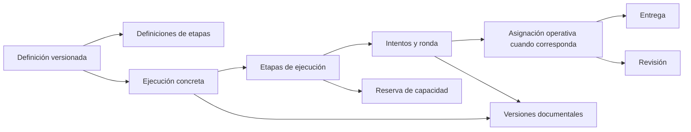

# Mapa de integración de secuencias

Fecha: 13 de octubre de 2026. Inspección de código; preparación para fase 2.
El [modelo de fase 2](modelo-datos.md) ya está implementado y probado en una copia.
Este mapa conserva el diagnóstico de integración; la migración aún no se aplicó al entorno de uso diario.

## Dependencias verificadas

Las rutas de código siguientes parten de `src/Sgol.Web/Infrastructure/Persistence/Planning/`.

| Componente | Comportamiento actual comprobado | Decisión necesaria para secuencias |
| --- | --- | --- |
| `OperationalTasks.cs` | `PersonId`, `StartsAt` y `DueAt` son obligatorios. `CK_operational_assignment_range` exige `DueAt > StartsAt`. | Representar etapa pendiente y reserva fuera de la asignación efectiva, o migrar contratos y lectores. No usar fechas ficticias. |
| `OperationalTasks.cs` | La entidad se divide físicamente en `operational_assignment`, `operational_submission` y `operational_review`. | Mantener esa separación; identificar etapa e intento sin trasladar el historial a la tabla raíz. |
| `OperationalPlanGenerator.cs` | Identidad de repetición por tarea, día y slot; genera asignaciones con fechas conocidas y selecciona personas mediante el ledger. | Incorporar identidad de ejecución y reservas de todas las etapas; impedir generación independiente duplicada. |
| `PlanningCapacity.cs` | La vista previa y su huella incluyen tareas, personas, pares de rotación y entradas del ledger. | Incluir definición versionada y reservas en vista previa, reparto y huella de concurrencia. |
| `OperationalCapacityService.cs` | Comparte reparto con generación y revisión; `RemainingMinutes` se calcula sobre asignaciones. | Unificar carga de reservas e intentos activos para contabilizar una sola vez. |
| `OperationalTaskService.Occasions.cs` | Una ocasión selecciona una tarea ocasional y exige rango conocido. | Definir inicio ocasional de una ejecución sin inventar vencimientos posteriores. |
| `OperationalTaskService.cs` | `CompleteAsync` escribe `CompletionKind = ENTREGA`; entrega y progreso verifican inicio. Usa bloqueo transaccional compartido. | Verificar dependencia, intento vigente, responsable y versión bajo el mismo bloqueo; avanzar atómicamente. |
| `OperationalSupervisionService.cs` | `ReviewAsync` registra `SUPERVISION` si no existe entrega. Reasignación crea otra asignación y amplía el plazo desde el momento actual. | Una decisión de etapa debe ser explícita; el cierre general no satisface una entrega. Una devolución conserva ronda y versiones; no reutilizar ciegamente el cálculo de plazo de reasignación. |
| `OperationalSupervisionService.cs` | La jerarquía de roles y exclusión de tareas propias restringen consultas supervisadas. | Añadir autorización contextual por ejecución sin ampliar `RolesFor`. La actuación de Dirección en su etapa exige un recorrido propio compatible. |
| `OperationalTaskService.cs`, `OperationalTaskService.Camera.cs`, `OperationalTaskService.History.cs` | Archivo e historial autorizan al propietario o a Supervisión; la captura tiene controles propios. | Compartir verificación de disponibilidad y autorización contextual con descarga directa e historial. |
| `LiveBoardReader.cs` | El tablero selecciona por `DueAt` del día; color y porcentaje dependen de fechas y `CompletedAt`. | Usar vencimiento efectivo y diferenciar entrega de etapa y autorización del proceso. |
| `EfDirectionPreparedPlanService.Deletion.cs` | El borrado elimina asignaciones, fragmentos y evidencias del plan dentro del flujo auditado e idempotente. | Impedir borrado de procesos activos; ampliar vista previa y preservación de referencias antes de generar secuencias. |

## Decisión de compatibilidad adoptada en fase 2

La opción que conserva mejor los contratos actuales es representar las etapas previstas,
sus reservas y las fechas desconocidas en entidades de ejecución separadas. La asignación
operativa se crearía al disponer de responsable válido y rango efectivo válido.
El esquema y las pruebas representan esas fechas y los intentos preparados sin asignación.
La integración de las reservas con la vista previa y la capacidad sigue pendiente de fase 3.

Si un vencimiento fijo ya pasó al cumplirse la dependencia, la etapa debe conservar
su límite y registrar el bloqueo. No se puede crear una asignación con rango inválido
ni desplazar el vencimiento silenciosamente. El tratamiento operativo está pendiente.

## Esquema conceptual del plan

El diccionario, las restricciones, las transiciones, el SQL y las pruebas de respaldo
y recuperación se describen en el [modelo de datos](modelo-datos.md). Las asignaciones
independientes y sus evidencias se conservaron en la copia de prueba.

## Recorrido integrado al 13/10/2026

- `/tareas/procesos`: `OperationalProcessCatalogService` crea y guarda borradores,
  valida pertenencia y publica snapshots; activar habilita nuevas planificaciones.
- `/planificacion/procesos`: `ProcessPlanningService` carga la publicación,
  revisa fechas/responsables/capacidad, prepara el plan y activa sus inicios.
- `PreparedReservationsAsync` y `OperationalCapacityService.LedgerAsync` cuentan
  las reservas sin duplicar las asignaciones efectivas de `OperationalProcessService`.
- `/mi-trabajo/procesos`: entrega, revisión, devoluciones, aceptación e historial
  contextual de PDFs. `OperationalProcessTimer` recupera las habilitaciones.
- Los recorridos independientes, cierre genérico, redistribución y borrado de planes
  verifican pertenencia y dependencias para impedir saltos o pérdida de historial.

La [verificación actual](verificacion-procesos.md) distingue lo integrado de la
redistribución contextual y vistas agregadas todavía pendientes.
